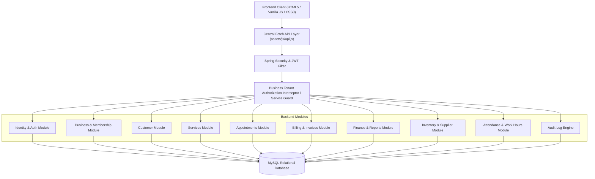

# VyaparOS System Architecture

## 1. Overview & Architectural Goals

VyaparOS is designed as a **modular monolithic backend** with a **responsive Vanilla JavaScript frontend**. The application strictly implements multi-tenant isolation, ensuring that every business workspace remains private and isolated from unauthorized cross-business queries.

---

## 2. Layered Architecture

Each backend module adheres to a strict 5-layer separation:

1. **Controller Layer (`*Controller.java`)**:
   - Thin REST endpoints exposing `/api/businesses/{businessId}/...`
   - Maps HTTP requests to Request DTOs with `@Valid`.
   - Delegates business checks and domain logic to the service layer.
   - Returns consistent `ResponseEntity<ApiResponse<T>>`.

2. **Service Layer (`*Service.java` / `*ServiceImpl.java`)**:
   - Core domain logic, validation, security permission checks, and transaction boundaries (`@Transactional`).
   - Tenant boundary enforcement: validates that the authenticated user holds an active membership in `businessId`.
   - Emits audit log entries on sensitive mutations.

3. **Repository Layer (`*Repository.java`)**:
   - Spring Data JPA interfaces.
   - Scoped queries containing `WHERE entity.business.id = :businessId` to prevent data leakage.

4. **Domain Entity Layer (`*Entity.java`)**:
   - Normalized JPA entities with constraints, foreign keys, and audit timestamps.
   - Monetary values mapped using `BigDecimal` (`precision = 12, scale = 2`).

5. **DTO & Mapper Layer**:
   - Clean Request / Response DTOs ensuring database entities are never directly serialized to the client.

---

## 3. Multi-Tenant Business Isolation Model

- **Shared Database, Isolated Records (Tenant Column Pattern)**:
  - Every tenant-owned entity has a mandatory foreign key `business_id` referencing `businesses(id)`.
  - The security layer inspects `SecurityContext` + `businessId` path parameter to verify active membership (`BusinessMembership`) and role permissions before executing any business queries.
  - Cross-tenant ID tampering (e.g. asking for customer ID 10 with business ID 2 when customer 10 belongs to business 1) results in an immediate `404 ResourceNotFoundException` or `403 ForbiddenException`.

---

## 4. Frontend Architecture

- **No heavy frontend frameworks**: Pure, highly optimized HTML5, modern CSS3 (with CSS custom properties, glassmorphism, responsive grid/flexbox), and Vanilla JS ES6 modules.
- **Centralized API Client (`assets/js/api.js`)**:
  - Automatically attaches `Authorization: Bearer <jwt_token>`.
  - Automatically injects current active `businessId`.
  - Handles 401 (token expiration) and 403 (insufficient permissions) gracefully.
  - Provides consistent loading, toast notification, and error rendering primitives.
