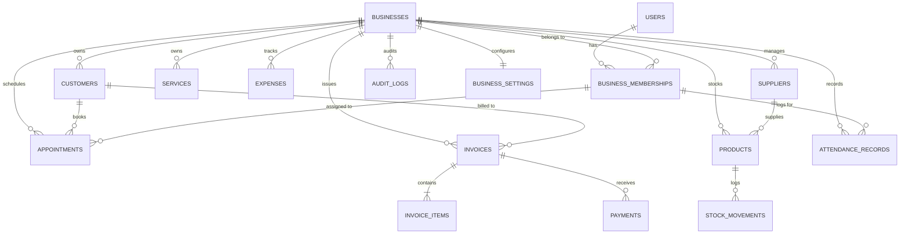

# VyaparOS Database Schema & Conventions

## 1. Entity-Relationship Overview

---

## 2. Table Specifications

### 2.1 Identity & Workspaces
- `users`: `(id BIGINT PK AUTO_INCREMENT, email VARCHAR(150) UNIQUE, password_hash VARCHAR(255), full_name VARCHAR(100), phone VARCHAR(30), is_active BOOLEAN, created_at DATETIME, updated_at DATETIME)`
- `businesses`: `(id BIGINT PK AUTO_INCREMENT, name VARCHAR(150), business_type VARCHAR(50), currency VARCHAR(10), timezone VARCHAR(50), address TEXT, phone VARCHAR(30), email VARCHAR(150), is_active BOOLEAN, created_at DATETIME, updated_at DATETIME)`
- `business_memberships`: `(id BIGINT PK AUTO_INCREMENT, user_id BIGINT FK, business_id BIGINT FK, role VARCHAR(30) [OWNER, ADMIN, STAFF], is_active BOOLEAN, joined_at DATETIME, UNIQUE(user_id, business_id))`

### 2.2 Customers & Services
- `customers`: `(id BIGINT PK AUTO_INCREMENT, business_id BIGINT FK, name VARCHAR(120), phone VARCHAR(30), email VARCHAR(120), address TEXT, notes TEXT, is_archived BOOLEAN, created_at DATETIME, updated_at DATETIME, INDEX(business_id, phone), INDEX(business_id, name))`
- `services`: `(id BIGINT PK AUTO_INCREMENT, business_id BIGINT FK, name VARCHAR(120), description TEXT, duration_minutes INT, price DECIMAL(12,2), is_active BOOLEAN, created_at DATETIME, updated_at DATETIME, INDEX(business_id, is_active))`

### 2.3 Appointments
- `appointments`: `(id BIGINT PK AUTO_INCREMENT, business_id BIGINT FK, customer_id BIGINT FK, service_id BIGINT FK, staff_membership_id BIGINT FK, start_time DATETIME, end_time DATETIME, status VARCHAR(30) [SCHEDULED, CONFIRMED, IN_PROGRESS, COMPLETED, CANCELLED, NO_SHOW], price_snapshot DECIMAL(12,2), notes TEXT, created_at DATETIME, updated_at DATETIME, INDEX(business_id, start_time), INDEX(staff_membership_id, start_time))`

### 2.4 Invoices & Payments
- `invoices`: `(id BIGINT PK AUTO_INCREMENT, business_id BIGINT FK, invoice_number VARCHAR(60), customer_id BIGINT FK NULLABLE, invoice_date DATE, due_date DATE, subtotal DECIMAL(12,2), discount_amount DECIMAL(12,2), tax_amount DECIMAL(12,2), total_amount DECIMAL(12,2), paid_amount DECIMAL(12,2), balance_due DECIMAL(12,2), status VARCHAR(30) [DRAFT, ISSUED, PARTIALLY_PAID, PAID, OVERDUE, VOID], notes TEXT, created_at DATETIME, updated_at DATETIME, UNIQUE(business_id, invoice_number))`
- `invoice_items`: `(id BIGINT PK AUTO_INCREMENT, invoice_id BIGINT FK, item_type VARCHAR(30) [SERVICE, PRODUCT, CUSTOM], item_id BIGINT NULLABLE, item_name VARCHAR(150), quantity INT, unit_price DECIMAL(12,2), line_total DECIMAL(12,2))`
- `payments`: `(id BIGINT PK AUTO_INCREMENT, business_id BIGINT FK, invoice_id BIGINT FK, amount DECIMAL(12,2), payment_date DATETIME, payment_method VARCHAR(30) [CASH, CARD, BANK_TRANSFER, UPI, OTHER], transaction_reference VARCHAR(100), recorded_by_user_id BIGINT FK, notes TEXT, created_at DATETIME)`

### 2.5 Finance & Expenses
- `expenses`: `(id BIGINT PK AUTO_INCREMENT, business_id BIGINT FK, category VARCHAR(60), description TEXT, amount DECIMAL(12,2), expense_date DATE, payment_method VARCHAR(30), vendor VARCHAR(120), created_by_user_id BIGINT FK, created_at DATETIME, updated_at DATETIME, INDEX(business_id, expense_date))`

### 2.6 Inventory & Suppliers
- `suppliers`: `(id BIGINT PK AUTO_INCREMENT, business_id BIGINT FK, name VARCHAR(120), contact_person VARCHAR(100), phone VARCHAR(30), email VARCHAR(120), address TEXT, is_active BOOLEAN, created_at DATETIME, updated_at DATETIME)`
- `products`: `(id BIGINT PK AUTO_INCREMENT, business_id BIGINT FK, sku VARCHAR(60), name VARCHAR(150), description TEXT, category VARCHAR(60), supplier_id BIGINT FK NULLABLE, purchase_cost DECIMAL(12,2), selling_price DECIMAL(12,2), current_stock INT, reorder_threshold INT, is_active BOOLEAN, created_at DATETIME, updated_at DATETIME, INDEX(business_id, sku))`
- `stock_movements`: `(id BIGINT PK AUTO_INCREMENT, business_id BIGINT FK, product_id BIGINT FK, movement_type VARCHAR(30) [RECEIVED, ADJUSTMENT, SALE, RETURN, DAMAGE], quantity_change INT, previous_stock INT, new_stock INT, reason VARCHAR(255), reference_id VARCHAR(100), recorded_by_user_id BIGINT FK, created_at DATETIME)`

### 2.7 Attendance & Audit
- `attendance_records`: `(id BIGINT PK AUTO_INCREMENT, business_id BIGINT FK, staff_membership_id BIGINT FK, clock_in_time DATETIME, clock_out_time DATETIME NULLABLE, duration_minutes INT NULLABLE, status VARCHAR(30) [OPEN, COMPLETED, CORRECTED], notes TEXT, created_at DATETIME, updated_at DATETIME, INDEX(staff_membership_id, clock_in_time))`
- `attendance_corrections`: `(id BIGINT PK AUTO_INCREMENT, attendance_record_id BIGINT FK, corrected_by_user_id BIGINT FK, previous_clock_in DATETIME, previous_clock_out DATETIME, new_clock_in DATETIME, new_clock_out DATETIME, reason TEXT, created_at DATETIME)`
- `audit_logs`: `(id BIGINT PK AUTO_INCREMENT, business_id BIGINT FK, user_id BIGINT FK, action VARCHAR(100), entity_type VARCHAR(60), entity_id VARCHAR(60), details JSON/TEXT, reason TEXT NULLABLE, timestamp DATETIME, INDEX(business_id, timestamp))`
- `business_settings`: `(id BIGINT PK AUTO_INCREMENT, business_id BIGINT FK UNIQUE, tax_rate DECIMAL(5,2), tax_name VARCHAR(50), invoice_prefix VARCHAR(20), default_appointment_duration INT, opening_time TIME, closing_time TIME, settings_json TEXT)`

---

## 3. Database Conventions
- All primary keys: `BIGINT AUTO_INCREMENT`
- Monetary calculations: `DECIMAL(12,2)`
- Time tracking: UTC timestamps in database, formatted to business timezone in DTOs.
- Foreign keys with referential constraints and indexes.
